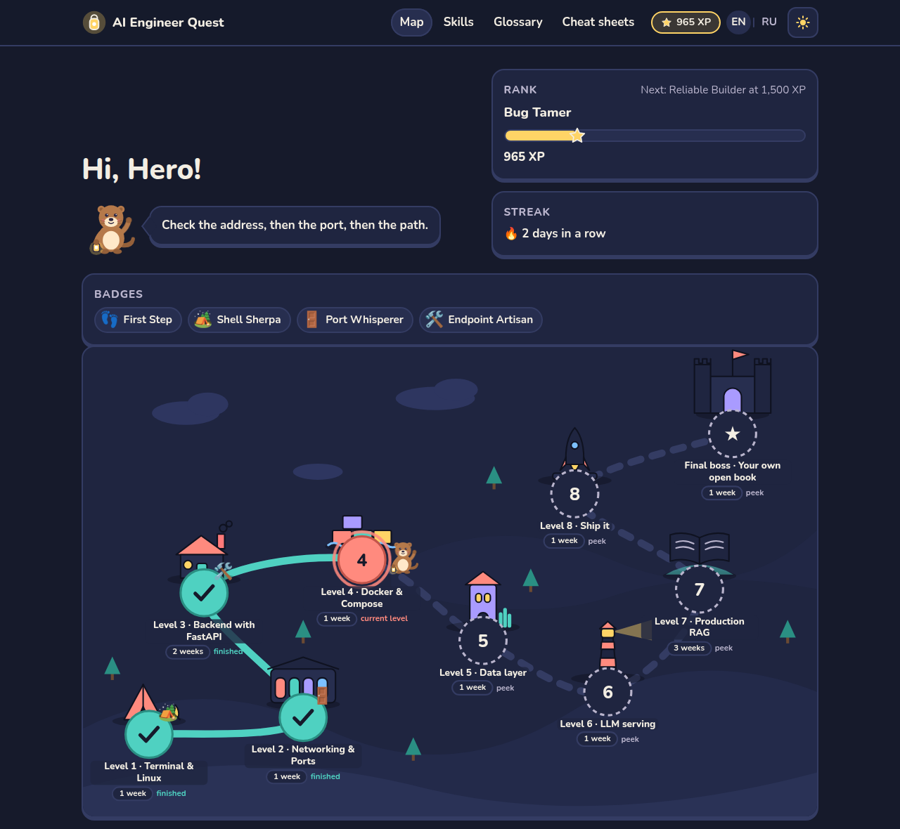
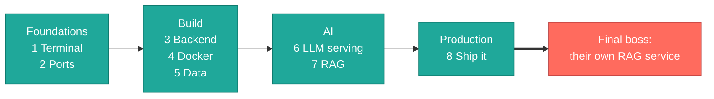
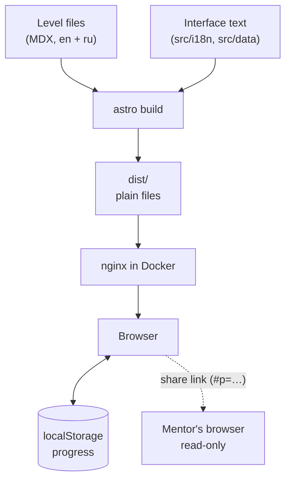

<div align="center">

# AI Engineer Quest

**A quest map for growing as an AI engineer: eight levels, one final boss, about twelve weeks.**




</div>

## What it is

A static learning website for one learner and one mentor. It covers the things that are usually hard early in an AI engineering career: the terminal, ports, backend, Docker, databases, LLM serving, production RAG and shipping. Every level explains the idea, lets the learner play with it, gives missions to build, things to break on purpose, a quiz and a deliverable.

There is no backend and no account. Progress is saved in the browser, and a share link shows the map to the mentor read-only. The whole site is in English and Russian.



## Pages

| Page | Address | What is there |
|------|---------|---------------|
| Quest map | `/en/`, `/ru/` | The map, XP, rank, streak, badges, "today's next step", share link |
| Level | `/en/level/1` … `8` | Explanation, diagrams, widgets, missions, breaks, traps, quiz, deliverable |
| Final boss | `/en/boss` | Project brief, 12 requirements, rubric, printable certificate |
| Skills | `/en/skills` | Starting → confident matrix with self-rating and a radar chart |
| Glossary | `/en/glossary` | 46 terms, one plain sentence and one analogy each, with a filter |
| Cheat sheets | `/en/cheatsheets` | One printable page per level |
| Mentor guide | `/en/mentor` | Weekly 30-minute agenda, how to review, pacing |

## How it works



- Level content lives in `src/content/levels/<lang>/`. A test fails if the English and Russian file of a level differ in structure.
- Widgets are small Preact islands; their logic is in `src/lib/` and covered by tests.
- The share link carries the progress in the URL hash, which is never sent to a server.

## Quick start

You need Node 22.

```bash
npm ci
npm run dev
```

Open `http://localhost:4321`.

| Command | What it does |
|---------|--------------|
| `npm run dev` | Development server with reload |
| `npm run build` | Build the site into `dist/` |
| `npm run preview` | Serve the built site locally |
| `npm run check` | Type check (`astro check`) |
| `npm test` | Unit tests and the en/ru parity test |
| `npm run links` | Check the "Go deeper" links of every level |

### Run it in Docker

```bash
docker build -t ai-quest .
docker compose up -d
curl http://localhost:8080/healthz
```

The site is at `http://localhost:8080`. Stop it with `docker compose down`.

## Edit a level

1. Open the level in both languages, for example `src/content/levels/en/2-ports.mdx` and `src/content/levels/ru/2-ports.mdx`.
2. The frontmatter holds missions, breaks, traps, the quiz, links and the cheat sheet. The body below it is the explanation. The schema is in `src/content.config.ts`, the writing rules in [docs/spec/content-guide.md](docs/spec/content-guide.md).
3. Make the same change in both files, then run `npm test` and `npm run check`.

> [!IMPORTANT]
> Mission ids, break ids and quiz answer positions are shared by both languages and by saved progress. Change them in both files, and do not renumber missions that learners may already have ticked.

## Project structure

```text
src/
  content/levels/{en,ru}/   # one MDX file per level and language
  content/glossary/         # en.yaml, ru.yaml
  pages/[lang]/             # map, level, boss, skills, glossary, cheat sheets, mentor
  components/               # map, diagrams, widgets, Porto the otter, UI parts
  lib/                      # progress store, widget logic (tested)
  i18n/, data/              # interface text in both languages
  styles/                   # design tokens, components, print
tests/                      # vitest: logic and content parity
docs/spec/                  # product, design, i18n, content and widget specs
docs/BUILD-GUIDE.md         # the ordered build tasks
scripts/                    # deploy.sh, rollback.sh, check-links.mjs
Dockerfile, compose.yaml, nginx.conf, Caddyfile
```

## Deploy

The site is published on GitHub Pages: **https://shoplikov.github.io/ai-quest/**

Pushing a `v*` tag (or **Actions → Deploy → Run workflow**) runs `.github/workflows/deploy.yml`. It runs the checks, builds the site for the `/ai-quest/` sub-path (`BASE_PATH`) and publishes `dist/` to Pages. CI (`.github/workflows/ci.yml`) runs the checks on every branch push.

```bash
git tag v1.0.1 && git push origin v1.0.1
```

The site can still run on any server with Docker, served at the root:

```bash
./scripts/deploy.sh <server>
./scripts/rollback.sh <server> <tag>
```

`deploy.sh` builds the image locally, tags it with the git tag on `HEAD` (or the commit if there is none), sends it over SSH and starts it. [docs/SETUP-GITHUB-AWS.md](docs/SETUP-GITHUB-AWS.md) walks through that server setup.

## Troubleshooting

| Symptom | Fix |
|---------|-----|
| `npm test` fails with "same structure in en and ru" | The two language files of a level differ. The message shows the field. |
| Build fails with `Unknown diagram` | The `name` in `<Diagram name="…" />` is not registered in `src/components/Diagram.astro`. |
| Progress does not save | The browser blocks storage (private window). The site says so in a note and keeps progress until the tab closes. |
| `npm run links` says "check by hand" | That site refuses robots. Open the link in a browser. |

## Docs

- [Product spec](docs/spec/product.md) · [Design](docs/spec/design.md) · [Languages](docs/spec/i18n.md)
- [Content guide](docs/spec/content-guide.md) · [Level facts](docs/spec/levels.md) · [Widgets](docs/spec/widgets.md)
- [GitHub and AWS setup](docs/SETUP-GITHUB-AWS.md)
